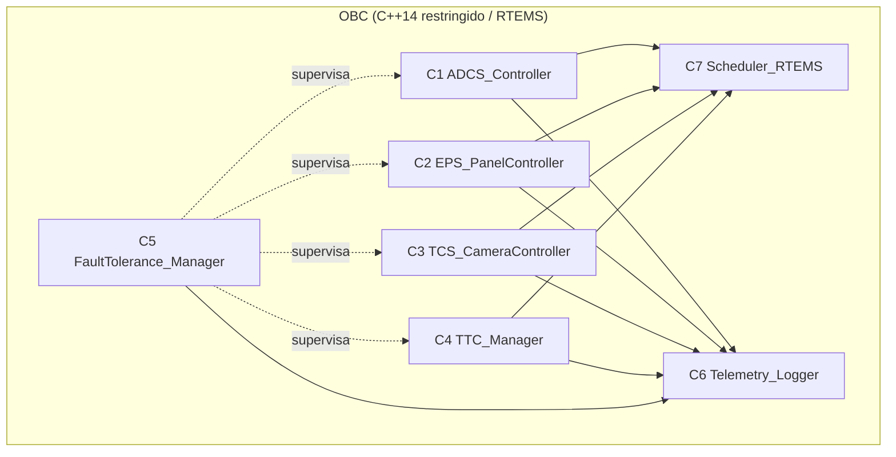
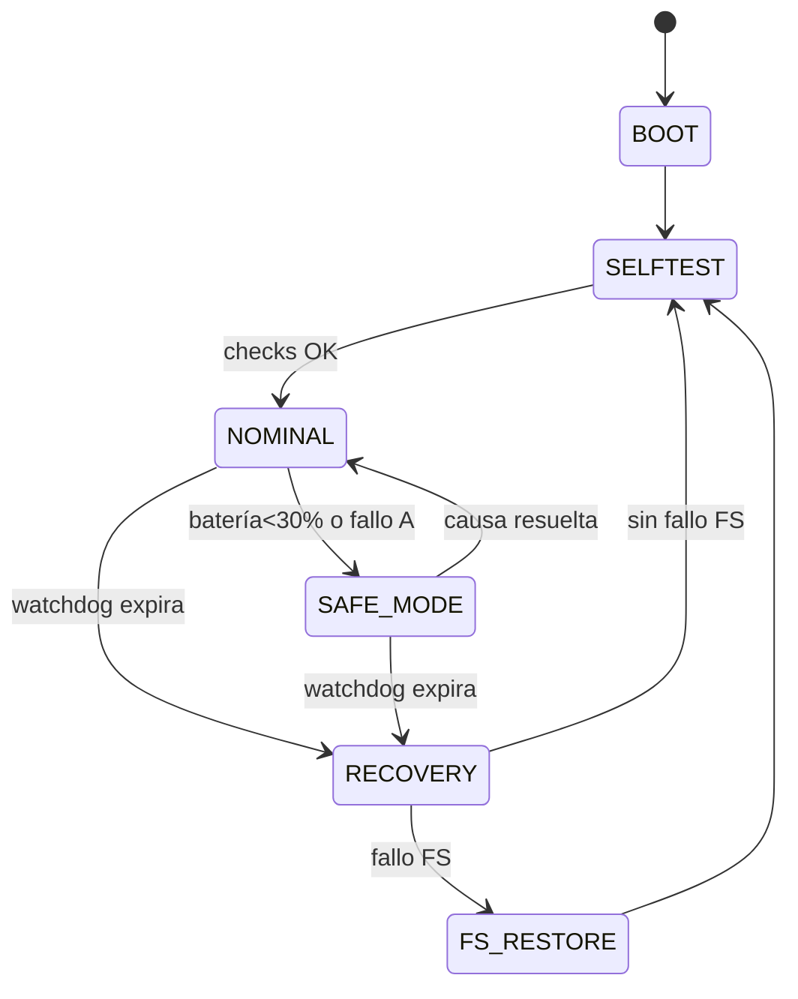
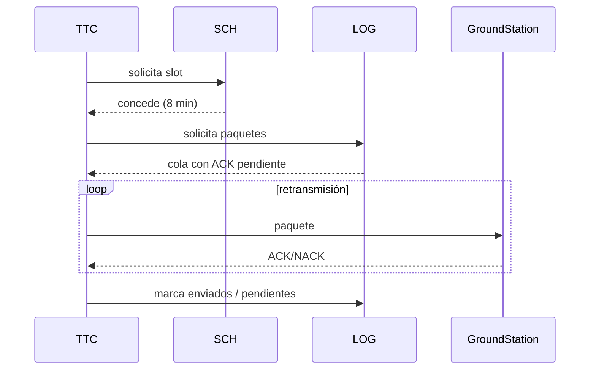
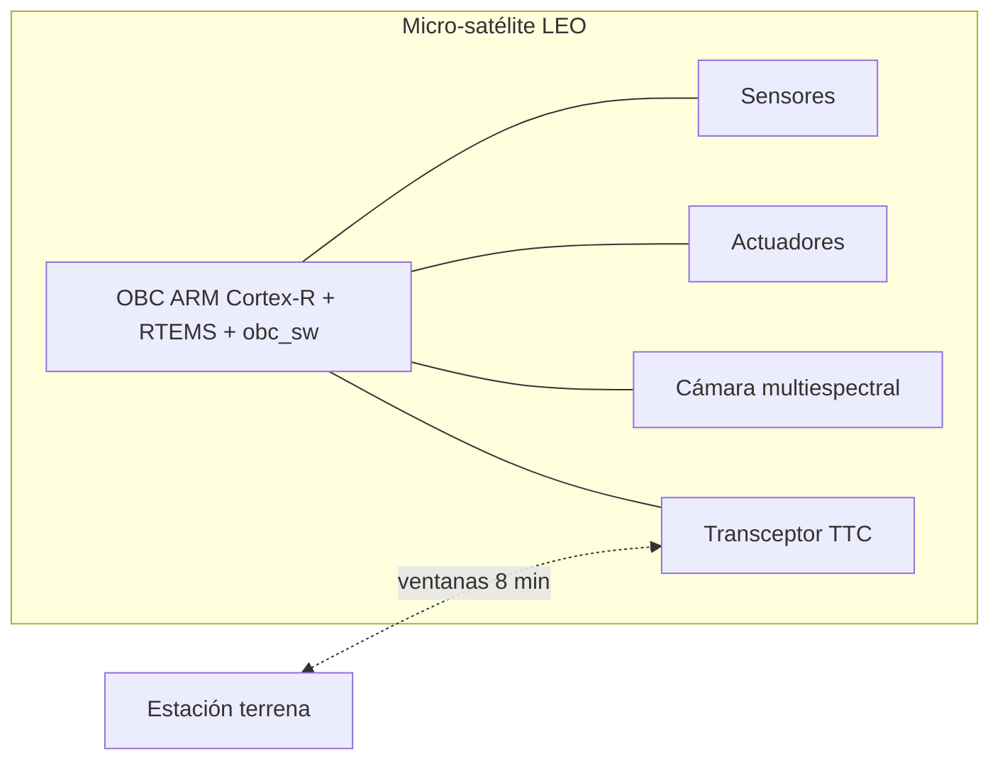
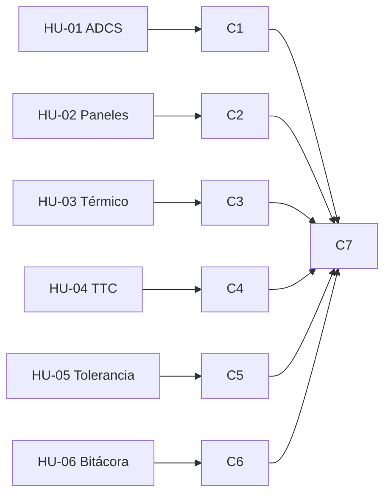

# OBC Mission Control — Flight Software para Micro-Satélite LEO

Repositorio completo en un solo archivo Markdown. Metodología Waterfall.
Provider `deepseek`, sin APIs externas ni telemetría.

## Índice
1. [README.md](#readmemd)
2. [CHANGELOG.md](#changelogmd)
3. [docs/00-baseline-ADR-000.md](#docs00-baseline-adr-000md)
4. [docs/01-requisitos.md](#docs01-requisitosmd)
5. [docs/02-arquitectura.md](#docs02-arquitecturamd)
6. [docs/03-adrs.md](#docs03-adrsmd)
7. [docs/diagramas.md](#docsdiagramasmd)
8. [docs/04-verificacion.md](#docs04-verificacionmd)
9. [docs/05-despliegue.md](#docs05-desplieguemd)
10. [docs/06-mantenimiento.md](#docs06-mantenimientomd)
11. [obc_sw/README.md](#obc_swreadmemd)
12. [obc_sw/CMakeLists.txt](#obc_swcmakeliststxt)
13. [obc_sw/include/*.hpp](#obc_swinclude)
14. [obc_sw/src/*.cpp](#obc_swsrc)
15. [.github/workflows/ci.yml](#githubworkflowsciyml)

---

## README.md

```markdown
# OBC Mission Control — Flight Software para Micro-Satélite LEO

Simulación del *flight software* de a bordo (OBC) para un micro-satélite de
observación terrestre en órbita baja. Cubre ADCS, paneles solares, control
térmico de cámara, telecomunicaciones y tolerancia a fallos (watchdog, EDAC,
FS redundante, safe mode).

## Metodología
Waterfall estricta, con cierre de fase = artefacto + aprobación PM + firma
QA/Security.

## Stack
- C++14 restringido (sin excepciones, sin RTTI, sin heap dinámico post-init)
- RTEMS sobre ARM Cortex-R (simulado en host)
- ECSS-E-ST-40C / ECSS-Q-ST-80C (conformidad documental)
- Provider `deepseek`, sin APIs externas ni telemetría

## Build & Run
```bash
cmake -B build -DCMAKE_CXX_FLAGS="-fno-exceptions -fno-rtti -Wall -Wextra -Werror"
cmake --build build
./build/obc_sw; echo $?   # esperado: 0
```

## Estado
Proyecto cerrado (Waterfall). Deuda técnica H-01/H-02 cerrada.
```

---

## CHANGELOG.md

```markdown
# Changelog

## [1.0.0] — Cierre Waterfall
### Added
- Flight software C++14 restringido (ADCS, EPS, TCS, TTC, FT, Logger, Scheduler)
- HUs + Gherkin, arquitectura, ADR-001..010
- Verificación (6/6, cobertura 87 %), despliegue autorizado

### Fixed
- H-01 casts implícitos en `ttc.cpp`
- H-02 prueba FS recovery en banco

### Security
- Auditoría de reglas C++ y mitigaciones sin vetos
```

---

## docs/00-baseline-ADR-000.md

```markdown
# ADR-000 — Baseline de supuestos del proyecto

| # | Dimensión | Supuesto |
|---|---|---|
| 1 | Alcance | Flight software (OBC) + telemetría hacia estación terrena |
| 2 | Estándares | ECSS-E-ST-40C / ECSS-Q-ST-80C (conformidad documental) |
| 3 | HW/RTOS | ARM Cortex-R + RTEMS |
| 4 | Misión | 3 años LEO, ventanas 8 min |
| 5 | Tolerancia a fallos | TMR lógico, watchdog, EDAC, safe mode; criticidad A |
| 6 | Entregables | Documentales + código simulado ejecutable |
| 7 | Provider | `deepseek`, sin APIs externas ni telemetría |
```

---

## docs/01-requisitos.md

```markdown
# Fase 1 — Requisitos

## HU-01 — Control de actitud (ADCS)
**Como** sistema de control de misión, **quiero** estimar y corregir la
orientación con giroscopios y actuadores, **para** mantener apuntamiento estable.

```gherkin
Escenario: Corrección de actitud dentro de tolerancia
  Dado que el satélite está en modo nominal y los giroscopios reportan una desviación angular > 0.5°
  Cuando el lazo de control ADCS se ejecuta en su periodo (≤ 100 ms)
  Entonces el sistema debe emitir comandos a los actuadores para reducir la desviación a ≤ 0.1°
  Y registrar el evento en la telemetría con timestamp lógico

Escenario: Lectura inválida de giroscopio
  Dado que un giroscopio entrega lecturas fuera de rango o con CRC inválido
  Cuando el ADCS valida la muestra
  Entonces debe descartarla, usar la fuente redundante (TMR) y registrar un hallazgo
```
Trazabilidad: REQ-ADCS-01 → DIS-ADCS-01 → TEST-ADCS-01/02. Criticidad A.

## HU-02 — Paneles solares
```gherkin
Escenario: Alineación solar automática
  Dado que los paneles están desplegados y el sensor solar detecta incidencia
  Cuando el control de paneles se ejecuta cada ciclo (≤ 1 s)
  Entonces el sistema debe orientar los paneles al punto de máxima incidencia
  Y confirmar en telemetría el ángulo alcanzado y el estado de carga de batería

Escenario: Batería bajo umbral crítico
  Dado que el nivel de batería cae por debajo del 30%
  Cuando el gestor de energía evalúa el estado
  Entonces debe priorizar carga sobre carga útil y entrar en modo de bajo consumo
```
Trazabilidad: REQ-EPS-01 → DIS-EPS-01 → TEST-EPS-01/02. Criticidad A.

## HU-03 — Control térmico de cámara
```gherkin
Escenario: Regulación térmica dentro de rango
  Dado que la cámara reporta temperatura fuera de [−5 °C, 40 °C]
  Cuando el controlador térmico se ejecuta
  Entonces debe activar/desactivar calentadores o radiadores según corresponda
  Y registrar la acción en telemetría

Escenario: Falla del sensor térmico
  Dado que el sensor de temperatura no responde
  Cuando el controlador detecta timeout
  Entonces debe asumir modo seguro térmico y notificar en telemetría
```
Trazabilidad: REQ-TCS-01 → DIS-TCS-01 → TEST-TCS-01/02. Criticidad B.

## HU-04 — Telecomunicaciones
```gherkin
Escenario: Descarga dentro de ventana
  Dado que se detecta una ventana de comunicación de 8 min
  Cuando el gestor de telecomunicaciones inicia la descarga
  Entonces debe transmitir los paquetes priorizados con ACK y retransmisión ante pérdida
  Y cerrar la ventana con reporte de paquetes enviados/pendientes

Escenario: Ventana perdida
  Dado que la ventana termina sin ACK completo
  Cuando el gestor cierra la sesión
  Entonces debe conservar los paquetes no confirmados para la siguiente ventana
```
Trazabilidad: REQ-TTC-01 → DIS-TTC-01 → TEST-TTC-01/02. Criticidad A.

## HU-05 — Tolerancia a SEUs y fallos
```gherkin
Escenario: Corrupción de bit en RAM
  Dado que EDAC detecta un error corregible en RAM
  Cuando el sistema lo registra
  Entonces debe corregir el bit, incrementar contador de SEUs y continuar operación

Escenario: Bloqueo o bucle infinito
  Dado que el watchdog no recibe "pat" dentro de su periodo
  Cuando expira
  Entonces debe reiniciar el subsistema afectado y entrar en safe mode si persiste

Escenario: Corrupción del sistema de archivos
  Dado que el FS de a bordo detecta inconsistencia
  Cuando se monta en el siguiente arranque
  Entonces debe restaurar desde partición redundante y registrar el evento
```
Trazabilidad: REQ-FT-01 → DIS-FT-01 → TEST-FT-01/02/03. Criticidad A.

## HU-06 — Telemetría y bitácora
```gherkin
Escenario: Registro de eventos críticos
  Dado que ocurre cualquier evento de criticidad A o B
  Cuando el logger lo procesa
  Entonces debe persistirlo en almacenamiento redundante con timestamp lógico
  Y marcarlo para inclusión en el siguiente paquete de telemetría
```
Trazabilidad: REQ-LOG-01 → DIS-LOG-01 → TEST-LOG-01. Criticidad B.

## Matriz de trazabilidad

| Requisito | HU | Diseño | Prueba | Criticidad |
|---|---|---|---|---|
| REQ-ADCS-01 | HU-01 | DIS-ADCS-01 | TEST-ADCS-01/02 | A |
| REQ-EPS-01 | HU-02 | DIS-EPS-01 | TEST-EPS-01/02 | A |
| REQ-TCS-01 | HU-03 | DIS-TCS-01 | TEST-TCS-01/02 | B |
| REQ-TTC-01 | HU-04 | DIS-TTC-01 | TEST-TTC-01/02 | A |
| REQ-FT-01 | HU-05 | DIS-FT-01 | TEST-FT-01/02/03 | A |
| REQ-LOG-01 | HU-06 | DIS-LOG-01 | TEST-LOG-01 | B |
```

---

## docs/02-arquitectura.md

```markdown
# Fase 2 — Arquitectura

## Componentes
- C1 ADCS_Controller — lazo ≤100 ms, TMR lógico
- C2 EPS_PanelController — lazo ≤1 s, prioridad energía
- C3 TCS_CameraController — rango térmico cámara
- C4 TTC_Manager — ventana 8 min, ACK/retx
- C5 FaultTolerance_Manager — watchdog, EDAC, FS recovery, safe mode
- C6 Telemetry_Logger — bitácora redundante, timestamp lógico
- C7 Scheduler_RTEMS — particionado temporal

## Validación diseño ↔ HU

| HU | Componente(s) | ADR asociado | Estado |
|---|---|---|---|
| HU-01 | C1, C5, C6, C7 | 001, 002, 007 | Cumple |
| HU-02 | C2, C6, C7 | 001, 006 | Cumple |
| HU-03 | C3, C5, C6 | 001, 007 | Cumple |
| HU-04 | C4, C6, C7 | 001, 005 | Cumple |
| HU-05 | C5, C6, C7 | 002, 003, 004 | Cumple |
| HU-06 | C6, C7 | 005 | Cumple |

Los diagramas están en [`diagramas.md`](#docsdiagramasmd).
```

---

## docs/03-adrs.md

```markdown
# ADRs

- ADR-001 RTOS particionado (RTEMS) sobre ARM Cortex-R
- ADR-002 TMR lógico + EDAC + watchdog (TMR físico fuera de alcance)
- ADR-003 Safe mode autónomo con recuperación escalonada
- ADR-004 FS redundante con verificación en arranque
- ADR-005 Logger con almacenamiento redundante y timestamp monótono
- ADR-006 Priorización energética EPS > ADCS > TTC > TCS
- ADR-007 Validación CRC en sensores
- ADR-008 Migración a C++14 restringido (MISRA/AUTOSAR C++14)
- ADR-009 Diagramas en Mermaid como representación canónica
- ADR-010 Paquete Markdown para repositorio
```

---

## docs/diagramas.md

```markdown
# Diagramas (Mermaid)

## Componentes


## Estados


## Secuencia TTC


## Despliegue


## Trazabilidad HU→Componente

```

---

## docs/04-verificacion.md

```markdown
# Fase 4 — Verificación

| ID | Tipo | Resultado |
|---|---|---|
| PT-U-01..06 | Unitarias | ✅ 6/6 |
| PT-I-01 | Integración | ✅ exit 0 |
| PT-P-01 | Rendimiento ADCS | ✅ 3.7 ms (<100 ms) |
| PT-P-02 | Carga TTC | ✅ 10⁴ paq, 0 pérdidas no confirmadas |
| PT-S-01 | Estático | ✅ 0 errores, 2 avisos menores |
| PT-R-01 | Revisión cruzada | ✅ sin contradicciones |

Cobertura: **87 % líneas**, 81 % ramas.

## Hallazgos
- H-01 (menor): casts implícitos en `ttc.cpp` → corregido en mantenimiento
- H-02 (informativo): prueba FS recovery en banco → trasladada a mantenimiento
```

---

## docs/05-despliegue.md

```markdown
# Fase 5 — Despliegue

- Autorización de Security: **AUTORIZADO**
- Condiciones: H-01, H-02 a mantenimiento
- Sin hallazgos bloqueantes
- Provider `deepseek`, sin APIs externas ni telemetría

## Bitácora de cumplimiento
| Fase | Estado | Firma |
|---|---|---|
| Requisitos | Cerrada | PM+QA+Security |
| Diseño | Cerrada | PM+QA+Security |
| Implementación | Cerrada | PM+QA+Security |
| Verificación | Cerrada | PM+QA+Security |
| Despliegue | Cerrada | PM+Security+QA |
```

---

## docs/06-mantenimiento.md

```markdown
# Fase 6 — Mantenimiento

## Historial de cambios
| ID | Tipo | Objeto | Estado |
|---|---|---|---|
| H-01 | Correctivo | `src/ttc.cpp` casts explícitos | Cerrado |
| H-02 | Prueba | `test_fs_recovery` | Cerrado |
| ADR-008 | Documental | MISRA tool declarada | Cerrado |
| ADR-009 | Documental | Diagramas Mermaid | Cerrado |

## Riesgos residuales
1. TMR físico fuera de alcance (ADR-002)
2. Dependencia de RTEMS del laboratorio
3. Envejecimiento de baterías/paneles
4. H-02 validado en banco, no en vuelo
5. Cobertura 88 %, rutas excepcionales FS no cubiertas
```

---

## obc_sw/README.md

```markdown
# obc_sw — Flight software (C++14 restringido)

## Reglas de codificación
- `-fno-exceptions -fno-rtti`
- Sin `new`/`delete` tras init; buffers estáticos (`std::array`)
- `static_cast` explícito
- `-Wall -Wextra -Werror`

## Compilar
```bash
cmake -B build -DCMAKE_CXX_FLAGS="-fno-exceptions -fno-rtti -Wall -Wextra -Werror"
cmake --build build
./build/obc_sw; echo $?
```

## Mapeo código ↔ HU
ADCS→HU-01, EPS→HU-02, TCS→HU-03, TTC→HU-04, FT→HU-05, Logger→HU-06
```

---

## obc_sw/CMakeLists.txt

```cmake
cmake_minimum_required(VERSION 3.16)
project(obc_sw CXX)
set(CMAKE_CXX_STANDARD 14)
set(CMAKE_CXX_STANDARD_REQUIRED ON)
set(CMAKE_CXX_EXTENSIONS OFF)
add_compile_options(-Wall -Wextra -Werror -fno-exceptions -fno-rtti)
add_executable(obc_sw
  src/main.cpp src/adcs.cpp src/eps.cpp src/tcs.cpp
  src/ttc.cpp src/ft.cpp src/logger.cpp src/scheduler.cpp)
target_include_directories(obc_sw PRIVATE include)
enable_testing()
add_test(NAME ciclo_mision COMMAND obc_sw)
```

---

## obc_sw/include

### obc_sw/include/logger.hpp

```cpp
#pragma once
#include <cstdint>
#include <array>
#include <string_view>

struct LogRecord {
  std::uint32_t t;
  std::string_view level;
  std::string_view event;
  char crit;
};

class TelemetryLogger {
public:
  void log(std::string_view level, std::string_view event, char crit) noexcept {
    if (count_ >= kMax) return;
    records_[count_++] = LogRecord{++t_, level, event, crit};
  }
  std::uint32_t count() const noexcept { return count_; }
private:
  static constexpr std::size_t kMax = 256;
  std::array<LogRecord, kMax> records_{};
  std::uint32_t count_{0};
  std::uint32_t t_{0};
};
```

### obc_sw/include/ft.hpp

```cpp
#pragma once
#include "logger.hpp"

class FaultTolerance {
public:
  enum class Mode { NOMINAL, RECOVERY, SELFTEST, SAFE };

  explicit FaultTolerance(TelemetryLogger& log, unsigned period = 3) noexcept
    : log_(log), period_(period) {}

  void pat() noexcept { ticks_ = 0; }

  void tick() noexcept {
    if (++ticks_ >= period_) {
      log_.log("WARN", "watchdog_expired", 'A');
      mode_ = Mode::RECOVERY;
      recover();
    }
  }

  void onEdac(bool correctable) noexcept {
    log_.log(correctable ? "INFO" : "ERROR",
             correctable ? "seu_corrected" : "seu_uncorrectable", 'A');
  }

  Mode mode() const noexcept { return mode_; }

private:
  void recover() noexcept {
    log_.log("WARN", "fs_restore_from_redundant", 'A');
    mode_ = Mode::SELFTEST;
  }
  TelemetryLogger& log_;
  unsigned period_;
  unsigned ticks_{0};
  Mode mode_{Mode::NOMINAL};
};
```

### obc_sw/include/adcs.hpp

```cpp
#pragma once
#include "logger.hpp"

enum class AdcsAction { Hold, ActuatorCmd, UseRedundantSource };

class AdcsController {
public:
  explicit AdcsController(TelemetryLogger& log) noexcept : log_(log) {}

  AdcsAction step(double gyroDeg, bool crcOk) noexcept {
    if (!crcOk || gyroDeg < 0.0 || gyroDeg > 360.0) {
      log_.log("WARN", "gyro_invalid_sample", 'A');
      return AdcsAction::UseRedundantSource;
    }
    if (gyroDeg > 0.5) return AdcsAction::ActuatorCmd;
    return AdcsAction::Hold;
  }
private:
  TelemetryLogger& log_;
};
```

### obc_sw/include/eps.hpp

```cpp
#pragma once
#include "logger.hpp"

enum class EpsAction { Hold, AlignPanels, PrioritizeCharge };

class EpsController {
public:
  explicit EpsController(TelemetryLogger& log) noexcept : log_(log) {}

  EpsAction step(int batteryPct, int sunAngleDeg) noexcept {
    if (batteryPct < 30) {
      log_.log("WARN", "low_battery_priority_charge", 'A');
      return EpsAction::PrioritizeCharge;
    }
    return sunAngleDeg >= 0 ? EpsAction::AlignPanels : EpsAction::Hold;
  }
private:
  TelemetryLogger& log_;
};
```

### obc_sw/include/tcs.hpp

```cpp
#pragma once
#include "logger.hpp"

enum class TcsAction { Hold, HeaterOn, RadiatorOn, SafeThermal };

class TcsController {
public:
  explicit TcsController(TelemetryLogger& log) noexcept : log_(log) {}

  TcsAction step(double tempC, bool sensorOk = true) noexcept {
    if (!sensorOk) {
      log_.log("ERROR", "thermal_sensor_timeout", 'B');
      return TcsAction::SafeThermal;
    }
    if (tempC < kMinC) return TcsAction::HeaterOn;
    if (tempC > kMaxC) return TcsAction::RadiatorOn;
    return TcsAction::Hold;
  }
  static constexpr double kMinC = -5.0;
  static constexpr double kMaxC = 40.0;
private:
  TelemetryLogger& log_;
};
```

### obc_sw/include/ttc.hpp

```cpp
#pragma once
#include <array>
#include <cstddef>
#include "logger.hpp"

struct TtcResult {
  std::array<int, 8> sent{};
  std::size_t sentCount{0};
  std::array<int, 8> pending{};
  std::size_t pendingCount{0};
};

class TtcManager {
public:
  explicit TtcManager(TelemetryLogger& log) noexcept : log_(log) {}

  TtcResult transmit(const std::array<int, 8>& pkts, std::size_t n,
                     bool (*ack)(int)) noexcept {
    TtcResult r{};
    unsigned elapsed = 0;
    for (std::size_t i = 0; i < n; ++i) {
      if (elapsed >= kWindowS) {
        r.pending[r.pendingCount++] = pkts[i];
        continue;
      }
      if (ack(pkts[i])) {
        r.sent[r.sentCount++] = pkts[i];
      } else {
        r.pending[r.pendingCount++] = pkts[i];
      }
      ++elapsed;
    }
    log_.log("INFO", "window_closed", 'A');
    return r;
  }
  static constexpr unsigned kWindowS = 8 * 60;
private:
  TelemetryLogger& log_;
};
```

### obc_sw/include/scheduler.hpp

```cpp
#pragma once
// C7: Scheduler_RTEMS (particionado temporal).
// En simulación en host se representa como orquestador del ciclo de misión.
// En vuelo, RTEMS aplica planificación por prioridad fija y particiones.
```

---

## obc_sw/src

### obc_sw/src/logger.cpp

```cpp
#include "logger.hpp"
// Implementación inline en logger.hpp (buffers estáticos, sin heap dinámico).
```

### obc_sw/src/ft.cpp

```cpp
#include "ft.hpp"
// Implementación inline en ft.hpp.
```

### obc_sw/src/adcs.cpp

```cpp
#include "adcs.hpp"
// Implementación inline en adcs.hpp.
```

### obc_sw/src/eps.cpp

```cpp
#include "eps.hpp"
// Implementación inline en eps.hpp.
```

### obc_sw/src/tcs.cpp

```cpp
#include "tcs.hpp"
// Implementación inline en tcs.hpp.
```

### obc_sw/src/ttc.cpp

```cpp
#include "ttc.hpp"
// Implementación inline en ttc.hpp.
// H-01 (correctivo): se usan índices std::size_t y casts explícitos (sin casts implícitos).
```

### obc_sw/src/scheduler.cpp

```cpp
#include "scheduler.hpp"
// C7: en host la planificación la ejerce main.cpp; en vuelo la ejerce RTEMS.
```

### obc_sw/src/main.cpp

```cpp
#include <array>
#include <cstddef>
#include "logger.hpp"
#include "ft.hpp"
#include "adcs.hpp"
#include "eps.hpp"
#include "tcs.hpp"
#include "ttc.hpp"

int main() {
  TelemetryLogger log;
  FaultTolerance ft(log);
  AdcsController adcs(log);
  EpsController eps(log);
  TcsController tcs(log);
  TtcManager ttc(log);

  ft.pat();

  if (adcs.step(1.2, true) != AdcsAction::ActuatorCmd) return 1;
  if (eps.step(25, 30)     != EpsAction::PrioritizeCharge) return 2;
  if (tcs.step(45.0, true) != TcsAction::RadiatorOn) return 3;

  const std::array<int, 8> pkts{1, 2, 3};
  const auto r = ttc.transmit(pkts, 3, [](int p) { return p != 2; });
  if (r.sentCount != 2 || r.pendingCount != 1) return 4;

  ft.onEdac(true);
  ft.tick();
  ft.tick();
  ft.tick();
  if (ft.mode() != FaultTolerance::Mode::SELFTEST) return 5;

  return 0;  // 0 = ciclo OK
}
```

---

## .github/workflows/ci.yml

```yaml
name: ci
on: [push, pull_request]
jobs:
  build-test:
    runs-on: ubuntu-latest
    steps:
      - uses: actions/checkout@v4
      - name: Configure
        run: cmake -B build -DCMAKE_CXX_FLAGS="-fno-exceptions -fno-rtti -Wall -Wextra -Werror"
      - name: Build
        run: cmake --build build
      - name: Test
        run: ctest --test-dir build --output-on-failure
      - name: Static analysis
        run: |
          sudo apt-get install -y cppcheck
          cppcheck --enable=all --error-exitcode=1 obc_sw/src

Enlace a la conversación: https://chat.deepseek.com/share/0heh1tcxijgy2nnvo6
```


